<p align="center">
  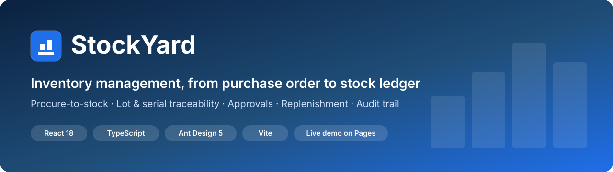
</p>

<h1 align="center">StockYard: Inventory Management System</h1>

<p align="center">
  <b>Procure-to-stock inventory software with a four-bucket stock ledger, lot &amp; serial traceability, purchase orders, goods receipts, approvals, transfers and replenishment planning.</b>
</p>

<p align="center">
  <a href="https://sdlc-corp.github.io/StockYard-MVP/"></a>
  <a href="https://github.com/SDLC-corp/StockYard-MVP/actions/workflows/deploy.yml"></a>
  <a href="LICENSE"></a>
  
  
  
</p>

<p align="center">
  <a href="https://sdlc-corp.github.io/StockYard-MVP/"><b>Try the live demo</b></a> ·
  <a href="#screenshots">Screenshots</a> ·
  <a href="#key-features">Features</a> ·
  <a href="#quick-start">Quick start</a> ·
  <a href="#faq">FAQ</a> ·
  <a href="https://sdlccorp.com/products/stockyard/">Product page</a>
</p>

---

**StockYard** is an **inventory management system** that links each step of buying and stocking material: **purchase order → approval → gate entry → inspection → goods receipt (GRN) → stock posting**. Every item, lot and serial number lives on **one immutable stock ledger** with four buckets: **on hand, reserved, blocked and in transit**. The system also covers **warehouse transfers**, **reorder-point replenishment**, a **single approval workflow**, **accounting periods** and a full **audit trail**.

This repository contains the **StockYard MVP**, a working live demo of the [StockYard product by SDLC Corp](https://sdlccorp.com/products/stockyard/). It runs entirely in the browser with realistic demo data, so you can try every workflow without installing anything.

### Try it in one click

No sign-up is needed. Each link opens the demo already signed in as that role:

| Role | What they do | Open demo as |
|---|---|---|
| 🧰 **Storekeeper** | Receives deliveries, issues & returns, reservations, transfers | [Storekeeper →](https://sdlc-corp.github.io/StockYard-MVP/?as=storekeeper#/) |
| 🛒 **Procurement** | Raises purchase orders and tracks them to receipt | [Procurement →](https://sdlc-corp.github.io/StockYard-MVP/?as=procurement#/acquisition/purchase-orders) |
| ✅ **Approver** | One queue to approve or reject POs and adjustments | [Approver →](https://sdlc-corp.github.io/StockYard-MVP/?as=approver#/approvals) |
| ⚙️ **Administrator** | Masters, periods, reconciliation, audit | [Administrator →](https://sdlc-corp.github.io/StockYard-MVP/?as=admin#/administration) |

You can also sign in with the username `storekeeper`, `procurement`, `approver` or `admin` and the password `demo`.

---

## Table of contents

- [Screenshots](#screenshots)
- [Key features](#key-features)
- [How the procure-to-stock workflow works](#how-the-procure-to-stock-workflow-works)
- [Stock ledger rules](#stock-ledger-rules)
- [Roles and permissions](#roles-and-permissions)
- [Who uses StockYard](#who-uses-stockyard)
- [Tech stack and architecture](#tech-stack-and-architecture)
- [Quick start](#quick-start)
- [Deploy to GitHub Pages](#deploy-to-github-pages)
- [5-minute demo walkthrough](#5-minute-demo-walkthrough)
- [FAQ](#faq)
- [Glossary](#glossary)
- [Roadmap](#roadmap)

---

## Screenshots

### Inventory dashboard
KPI tiles, inbound and outbound movement value, pending approvals, replenishment alerts and the latest ledger postings.

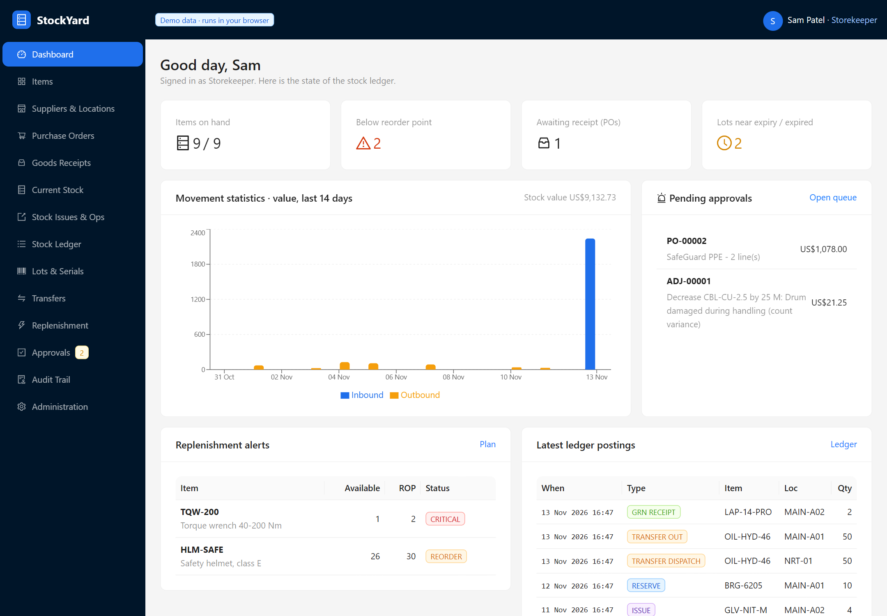

### Current stock by item, location and lot
Searchable balances across warehouses, near-expiry lot flags, and a bucket breakdown (on hand, reserved, blocked, in transit) for each item.

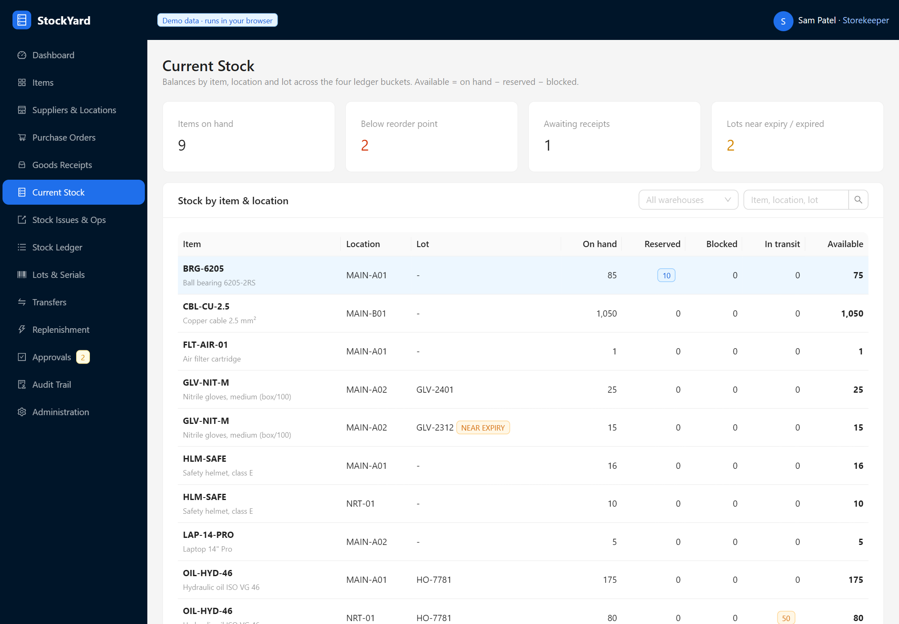

<table>
  <tr>
    <td width="50%"><b>Purchase order management</b><br/>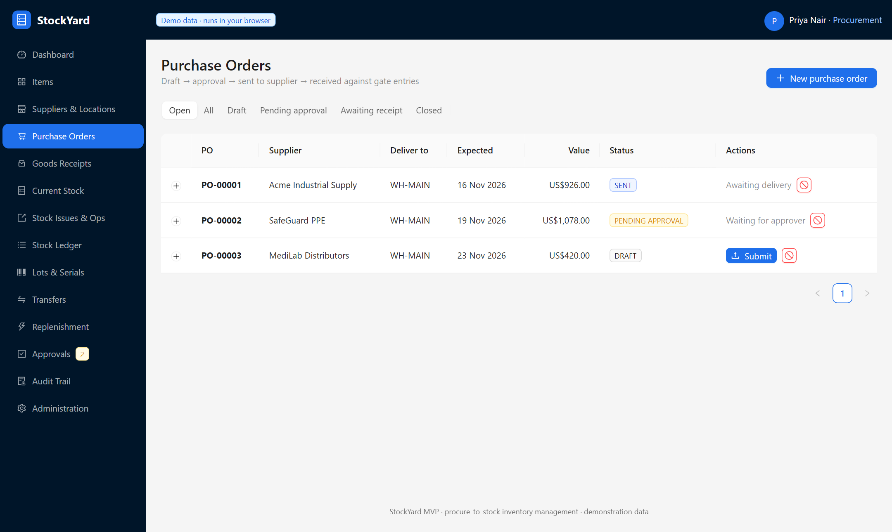</td>
    <td width="50%"><b>Gate entry and goods receipt (GRN)</b><br/>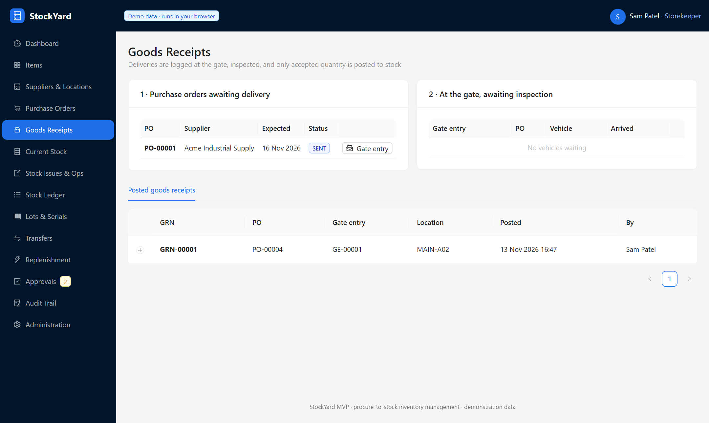</td>
  </tr>
  <tr>
    <td><b>Stock issues, returns, reservations and adjustments</b><br/>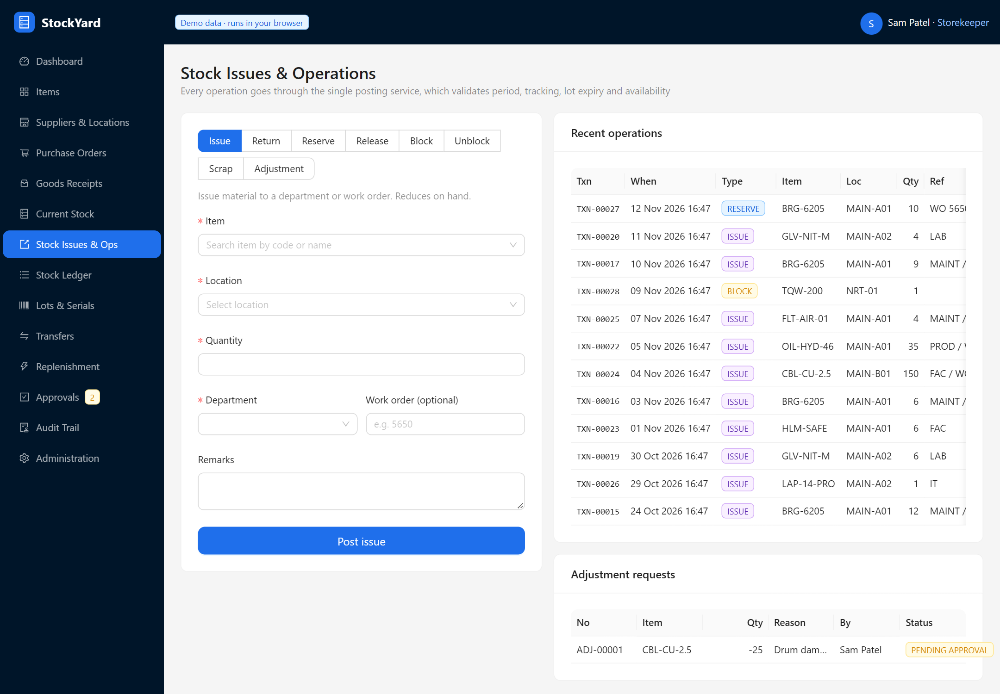</td>
    <td><b>Immutable stock ledger with reversals</b><br/>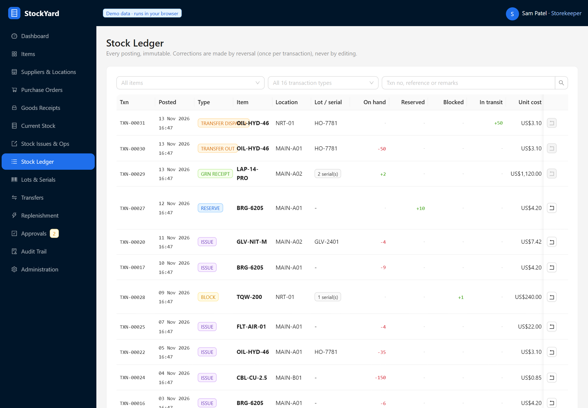</td>
  </tr>
  <tr>
    <td><b>Serial number tracking and maintenance history</b><br/>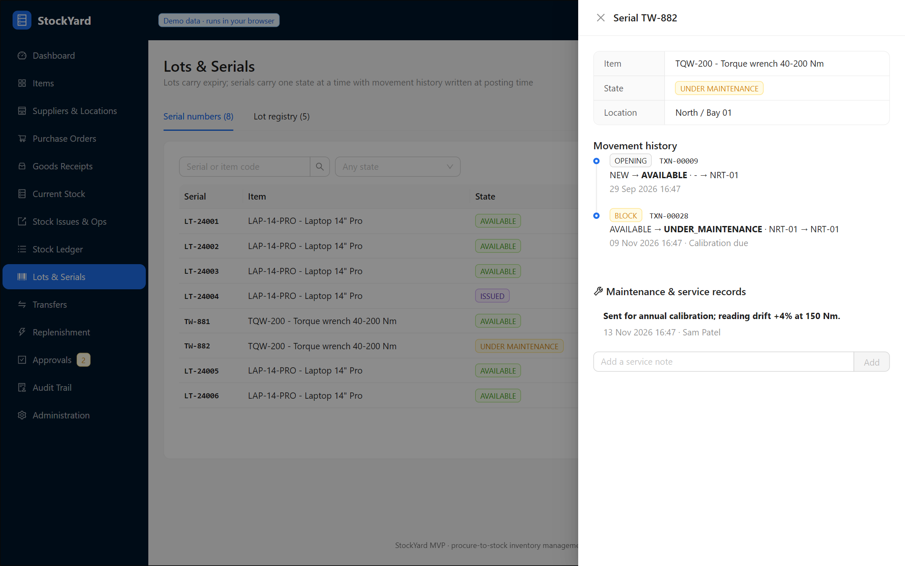</td>
    <td><b>Approval workflow</b><br/>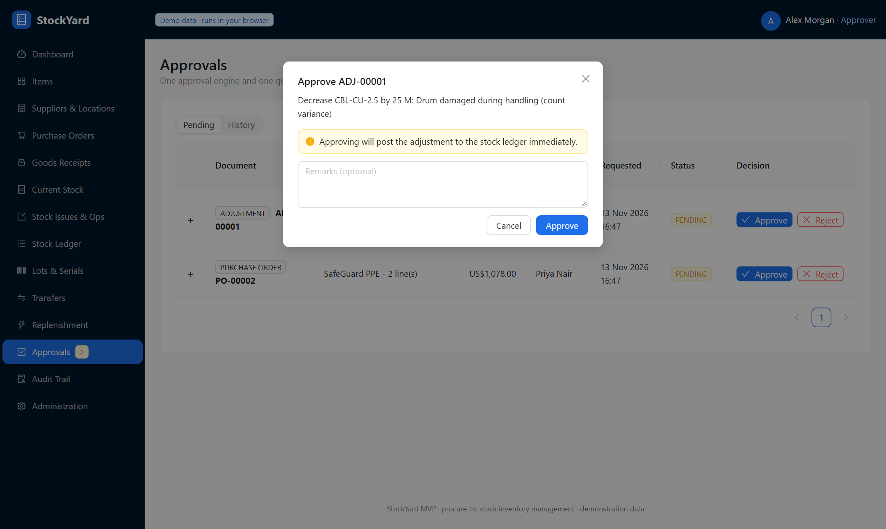</td>
  </tr>
  <tr>
    <td><b>Replenishment and reorder point planning</b><br/>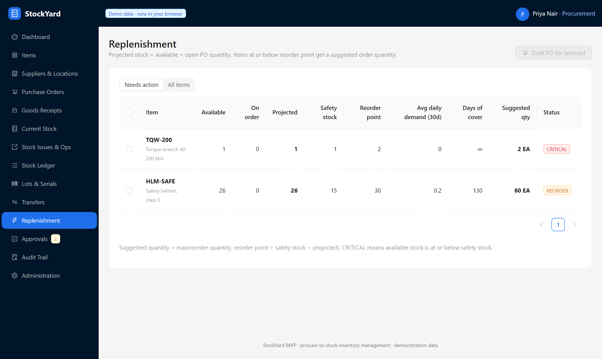</td>
    <td><b>Warehouse transfers (direct and in transit)</b><br/>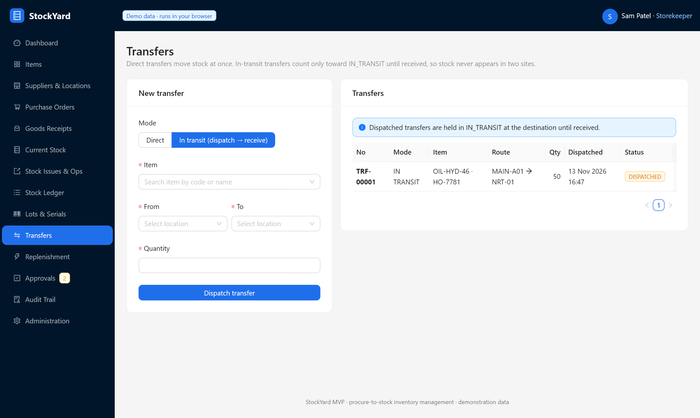</td>
  </tr>
  <tr>
    <td><b>Audit trail with old and new values</b><br/>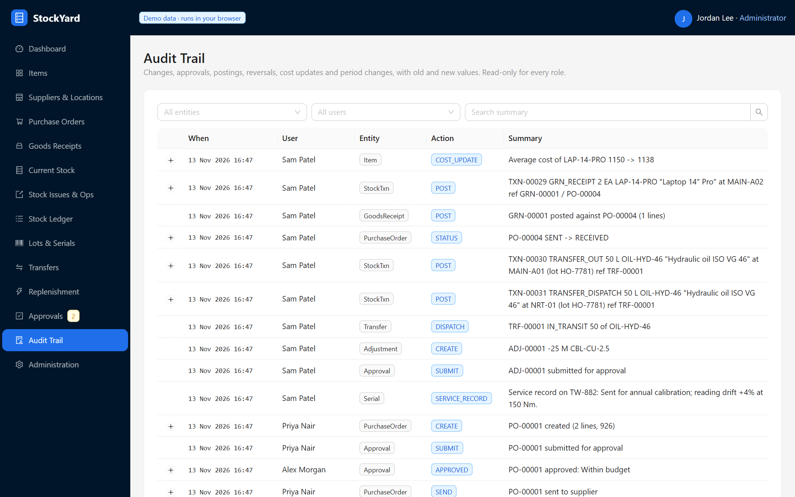</td>
    <td><b>Administration: periods and ledger reconciliation</b><br/>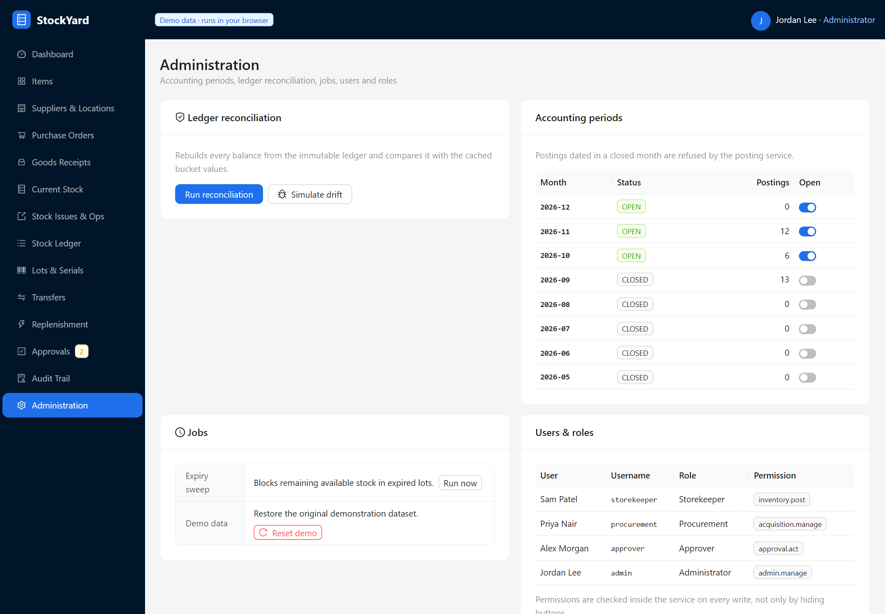</td>
  </tr>
</table>

<p align="center">
  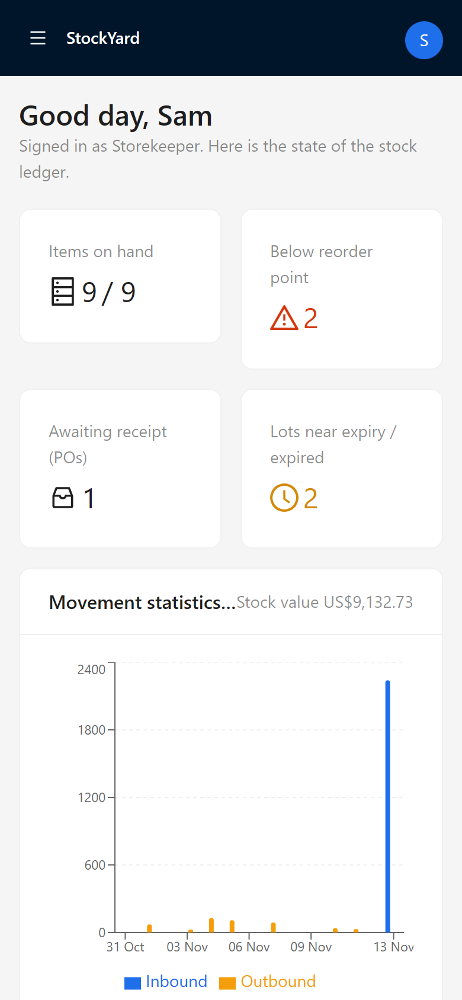
  &nbsp;&nbsp;
  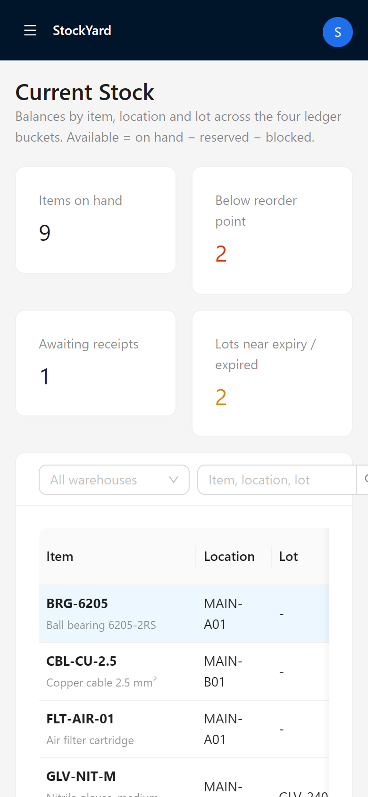
  &nbsp;&nbsp;
  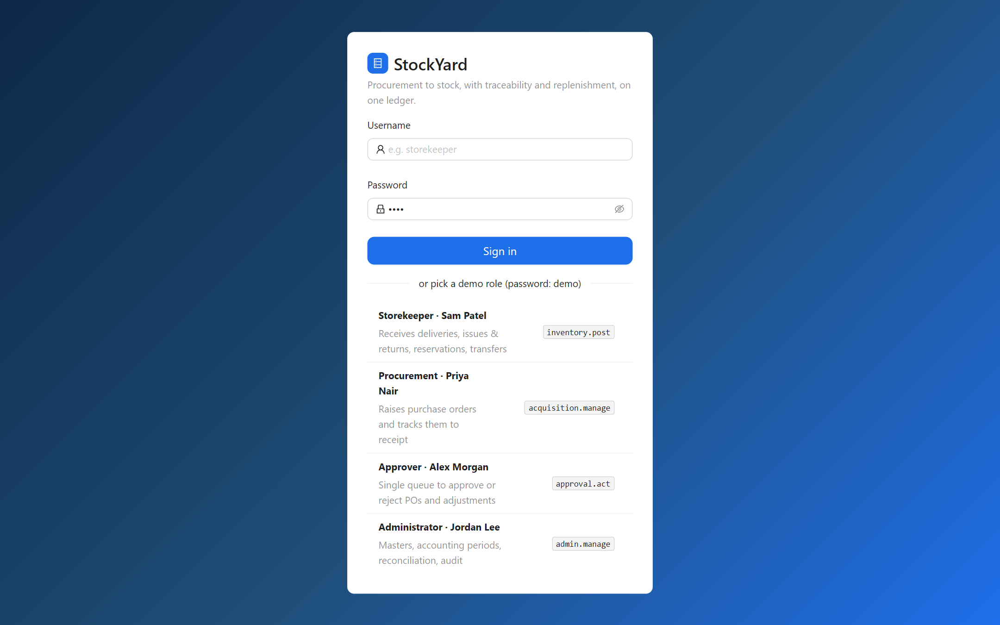
</p>

---

## Key features

| Module | Capabilities |
|---|---|
| **Purchase order management** | Multi-line POs, draft → submit → approve → send, order value, receipt progress per line, approval history, cancellation rules |
| **Receiving (GRN)** | Gate entry with vehicle details, inspection that splits **accepted vs. rejected** quantities, reject reasons, supplier lot number and expiry capture, serial number capture, partial receipts |
| **Inventory control** | Issue to department or work order, returns, reservations, blocks (quality hold or maintenance), scrap, and count adjustments routed through approval |
| **Stock ledger** | 16 transaction types, a bucket delta on every row, one-time reversals with a reason, filters by item, type and reference |
| **Lot & batch tracking** | Lot registry, expiry dates, near-expiry warnings (30 days), expired lots refused at posting, and an expiry sweep job that blocks expired stock |
| **Serial number tracking** | One state per unit (available, reserved, issued, in transit, under maintenance, damaged, scrapped), movement history written at posting time, and service records that stay with the serial |
| **Multi-warehouse transfers** | Direct transfers, or in-transit transfers where dispatch and receipt are separate steps and stock is never counted in two sites |
| **Replenishment planning** | Safety stock, reorder point, on-order quantity, projected stock, 30-day demand history, days of cover, suggested order quantity, and one-click draft PO |
| **Approval workflow** | One engine for POs and stock adjustments, remarks required on rejection, segregation of duties (requesters cannot approve their own requests), full history |
| **Costing** | Weighted average cost recalculated on every goods receipt, with stock value shown on the dashboard and per item |
| **Governance** | Accounting periods (closed months block postings), audit trail with old and new values, ledger reconciliation with rebuild, role-based access control |
| **Usability** | Searchable and dependent selects (item → location → lot → serial), live available quantity, plain-language reasons for disabled actions, responsive mobile layout, dark mode |

---

## How the procure-to-stock workflow works

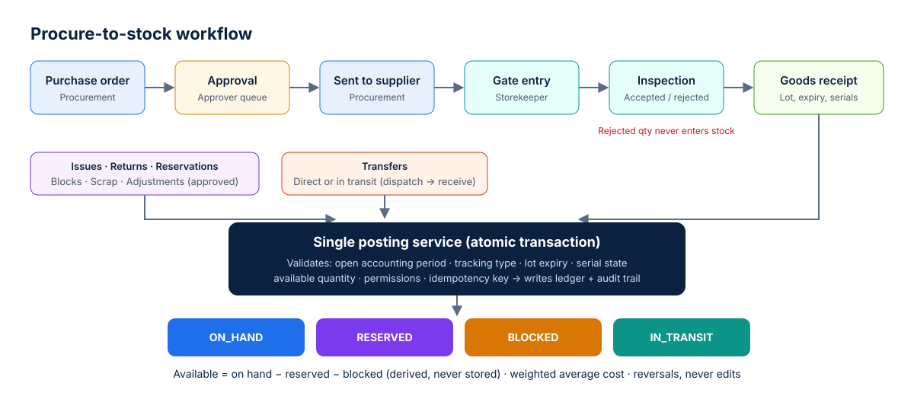

1. **Purchase order:** Procurement raises a PO against a supplier and delivery warehouse.
2. **Approval:** The PO goes to the shared approval queue. Nothing can be sent until it is approved.
3. **Send:** The approved PO is sent to the supplier and becomes *awaiting receipt*.
4. **Gate entry:** The storekeeper logs the delivery vehicle at the gate before anything counts as received.
5. **Inspection:** The received quantity is split into **accepted** and **rejected**. Rejected quantity never enters stock.
6. **Goods receipt:** Accepted quantity is posted to a location, with a lot and expiry or serial numbers, and the **weighted average cost** is recalculated.
7. **Ledger:** Every movement, including issues, transfers and adjustments, goes through the **same posting service** and lands on the **same ledger**.

---

## Stock ledger rules

| Rule | How StockYard enforces it |
|---|---|
| **Four buckets** | `ON_HAND`, `RESERVED`, `BLOCKED` and `IN_TRANSIT`, keyed by item × location × lot |
| **Derived availability** | `available = on hand − reserved − blocked`. It is computed, never stored |
| **Single posting service** | `postStock()` in [`src/domain/services.ts`](src/domain/services.ts) handles all 16 transaction types |
| **Atomic writes** | Each call runs in a transaction: the whole document posts, or nothing does |
| **Validation before writing** | Open accounting period, tracking type, lot expiry, serial state, available quantity and non-negative buckets |
| **Idempotency** | A repeated submission with the same key returns the original transaction instead of posting twice |
| **Immutability** | Posted rows are never edited or deleted. Corrections are reversals, and each transaction can be reversed once |
| **Reconciliation** | Rebuilds every balance from the ledger, compares it with cached values and reports or fixes drift |
| **Specific errors** | For example: *"Insufficient available stock for BRG-6205 at MAIN-A01: requested 80 EA, available 75 (on hand 85, reserved 10, blocked 0)."* |

**The 16 transaction types:** `OPENING`, `GRN_RECEIPT`, `ISSUE`, `RETURN`, `RESERVE`, `UNRESERVE`, `BLOCK`, `UNBLOCK`, `ADJUST_IN`, `ADJUST_OUT`, `TRANSFER_OUT`, `TRANSFER_IN`, `TRANSFER_DISPATCH`, `TRANSFER_RECEIVE`, `SCRAP`, `REVERSAL`.

---

## Roles and permissions

| Role | Permission | Can do |
|---|---|---|
| Storekeeper | `inventory.post` | Gate entry, goods receipt, issue, return, reserve, block, scrap, transfers, reversals, adjustment requests |
| Procurement | `acquisition.manage` | Create, submit, send and cancel purchase orders, and draft POs from replenishment |
| Approver | `approval.act` | Approve or reject POs and stock adjustments |
| Administrator | `admin.manage` | Items, suppliers, locations, accounting periods, reconciliation, expiry sweep |

Permissions are checked **inside the service on every write**, not only by hiding buttons. Switching to a role without a permission and trying the action returns a clear "Permission denied" message.

---

## Who uses StockYard

- **Manufacturing and spare parts:** issues against work orders, lot traceability back to supplier batches.
- **Distribution and 3PL:** multi-warehouse balances, in-transit transfers, demand-based reorder points.
- **Field service and asset management:** serialised equipment with maintenance and service history.
- **Healthcare, pharma and lab supplies:** batch and expiry control, with expired stock blocked automatically.
- **Campus and facilities management:** departmental issues that can be traced to who used what.
- **Regulated and public procurement:** defensible approval trails and audit logs.

---

## Tech stack and architecture

| Layer | Technology |
|---|---|
| UI | React 18, TypeScript (strict), Ant Design 5, Recharts, React Router (hash routing) |
| Build & test | Vite 5, Vitest, Testing Library (domain unit tests + UI smoke test) |
| Domain logic | Framework-free TypeScript: posting service, approval engine, PO/GRN/transfer services |
| Persistence (MVP) | Transactional in-browser store (clone → mutate → commit) persisted to `localStorage` |
| CI/CD | GitHub Actions → GitHub Pages |

```
src/
├─ domain/            # business rules: no React, ready to move behind a REST API
│  ├─ types.ts        # shared contracts: enums, entities, 16 transaction types
│  ├─ services.ts     # posting service, approvals, PO, GRN, transfers, admin
│  ├─ store.ts        # atomic transactional store + persistence
│  ├─ seed.ts         # demo dataset, created through the real services
│  └─ api.ts          # session + one-transaction-per-call API
├─ components/        # searchable dependent selects, status tags, action runner
└─ pages/             # one file per screen (14 screens)
```

The production StockYard platform runs this same domain model on **Node.js/Express** and **PostgreSQL with Prisma**, with 94 entities, 314 REST endpoints and 65 screens. This MVP keeps the business rules in [`src/domain`](src/domain) so they can move behind that API unchanged.

---

## Quick start

```bash
git clone https://github.com/SDLC-corp/StockYard-MVP.git
cd StockYard-MVP
npm install
npm run dev        # open http://localhost:5173
```

| Command | What it does |
|---|---|
| `npm run dev` | Start the dev server with hot reload |
| `npm test` | Run domain unit tests and the UI smoke test |
| `npm run build` | Type-check and build to `dist/` |
| `npm run preview` | Serve the production build locally |

Requires **Node.js 18+**.

---

## Deploy to GitHub Pages

1. Push to the `main` branch.
2. Open **Settings → Pages → Build and deployment**, then set **Source** to **GitHub Actions**.
3. [`.github/workflows/deploy.yml`](.github/workflows/deploy.yml) installs dependencies, runs the tests, builds the app and publishes it.

The build uses a relative base path and hash routing, so it works under any repository name without configuration.

---

## 5-minute demo walkthrough

1. **[As Approver](https://sdlc-corp.github.io/StockYard-MVP/?as=approver#/approvals):** approve **PO-00002** (SafeGuard PPE).
2. **[As Procurement](https://sdlc-corp.github.io/StockYard-MVP/?as=procurement#/acquisition/purchase-orders):** **Send** the PO. Then, in *Replenishment*, select the critical items and draft a new PO.
3. **[As Storekeeper](https://sdlc-corp.github.io/StockYard-MVP/?as=storekeeper#/receiving/goods-receipts):** log a **gate entry**, then **Inspect & receive**. Reject a few units and enter a lot and expiry. Check the new average cost in *Current Stock*.
4. **Storekeeper:** in *Stock Issues & Ops*, try to issue more than is available and read the error. Then try to issue from the expired lot **BUF-0921**.
5. **Storekeeper:** in *Transfers*, **receive** the in-transit hydraulic oil and watch `IN_TRANSIT` become `ON_HAND`.
6. **[As Administrator](https://sdlc-corp.github.io/StockYard-MVP/?as=admin#/administration):** click **Simulate drift**, run **reconciliation**, then rebuild. Close the current month and confirm that postings are refused.
7. **Anyone:** open **Audit Trail** to see every change with its old and new values.

*Administration → Reset demo* restores the original data at any time.

---

## FAQ

<details open>
<summary><b>What is StockYard?</b></summary>

StockYard is an inventory management system by SDLC Corp. It covers procurement through to stock: purchase orders, approvals, gate entry, goods receipts, a four-bucket stock ledger, lot and serial traceability, warehouse transfers, replenishment planning, accounting periods and an audit trail. This repository is a free, browser-based MVP and live demo.
</details>

<details>
<summary><b>Is there a free demo?</b></summary>

Yes. The live demo at <https://sdlc-corp.github.io/StockYard-MVP/> needs no sign-up. Pick a role (Storekeeper, Procurement, Approver or Administrator), or use the password `demo`.
</details>

<details>
<summary><b>How does StockYard calculate available stock?</b></summary>

Available quantity is derived as **on hand − reserved − blocked** for each item, location and lot. It is never stored, so it cannot drift from the ledger. In-transit stock is tracked in a separate bucket and is not counted as on hand until it is received.
</details>

<details>
<summary><b>Does StockYard support lot, batch and expiry tracking?</b></summary>

Yes. Lot-tracked items require a lot on every movement, and expiry is captured at goods receipt. Lots within 30 days of expiry are flagged, and expired lots are refused for issue, reservation and transfer. An expiry sweep job moves the remaining expired stock into `BLOCKED`.
</details>

<details>
<summary><b>Does StockYard support serial number tracking?</b></summary>

Yes. Each serialised unit has exactly one state at a time (available, reserved, issued, in transit, under maintenance, damaged or scrapped). Every posting writes the serial's movement history. Maintenance and service records stay with the serial across transfers.
</details>

<details>
<summary><b>How are mistakes corrected if the ledger is immutable?</b></summary>

By **reversal**. A reversal posts equal and opposite bucket movements and links back to the original transaction. Each transaction can be reversed only once, and both rows stay in the ledger and the audit trail.
</details>

<details>
<summary><b>What costing method does StockYard use?</b></summary>

Weighted average cost, recalculated on every goods receipt from the current on-hand quantity and the receipt's unit price. Each cost change is recorded in the audit trail with its old and new values.
</details>

<details>
<summary><b>Can StockYard handle multiple warehouses?</b></summary>

Yes. Balances are kept per item, location and lot across any number of warehouses and locations. Transfers can be direct, or in transit with separate dispatch and receive steps.
</details>

<details>
<summary><b>Where is data stored in the demo?</b></summary>

In the demo, data is stored in your browser's `localStorage`, so each visitor has a private copy. The production StockYard uses PostgreSQL, and can run in managed cloud, your own cloud tenancy, or fully on-premise.
</details>

<details>
<summary><b>How do I get StockYard for my business?</b></summary>

Contact SDLC Corp at **sales@sdlccorp.com** or visit the [StockYard product page](https://sdlccorp.com/products/stockyard/). Pricing depends on deployment model, modules, number of sites and users, and can be phased.
</details>

---

## Glossary

| Term | Meaning |
|---|---|
| **GRN (goods receipt note)** | The document that posts accepted delivered quantity into stock |
| **Gate entry** | A record that a supplier delivery arrived, logged before inspection |
| **On hand** | Physical quantity at a location |
| **Reserved** | Quantity held for a work order or demand, not available to others |
| **Blocked** | Quantity on quality hold, under maintenance or expired |
| **In transit** | Quantity dispatched between locations and not yet received |
| **Safety stock** | Buffer quantity kept against demand variability |
| **Reorder point (ROP)** | The projected stock level at which a replenishment order should be raised |
| **Days of cover** | Available stock ÷ average daily demand |
| **Weighted average cost** | Unit cost blended across all receipts by quantity |

---

## Roadmap

The MVP runs client-side. The full StockYard platform adds:

- [ ] Express + PostgreSQL (Prisma) backend with JWT authentication and `numeric` quantities and money
- [ ] Requirements → requisitions → RFQs → quotation comparison → split PO awards
- [ ] Budgets and commitments, supplier invoices, payment requests and payment advice
- [ ] Forecast rules, maintenance alerts and scheduled jobs
- [ ] Reports: expiry, pending transactions, material movement statistics, inbound summary
- [ ] CSV/Excel import and export, barcode and QR scanning

---

## Keywords

`inventory management system` · `stock management software` · `warehouse management` · `inventory control` · `procure to stock` · `procure to pay` · `purchase order management` · `goods receipt note (GRN)` · `gate entry` · `stock ledger` · `lot tracking` · `batch and expiry tracking` · `serial number tracking` · `asset tracking` · `multi-warehouse inventory` · `stock transfer` · `reorder point` · `safety stock` · `replenishment planning` · `approval workflow` · `audit trail` · `weighted average cost` · `role-based access control` · `React inventory app` · `TypeScript` · `Ant Design` · `open source inventory demo`

---

<p align="center">
  <b>StockYard</b> is a product of <a href="https://sdlccorp.com/products/stockyard/">SDLC Corp</a>.<br/>
  For a scoped proposal or a demo of the full platform, email <a href="mailto:sales@sdlccorp.com">sales@sdlccorp.com</a>.
</p>
